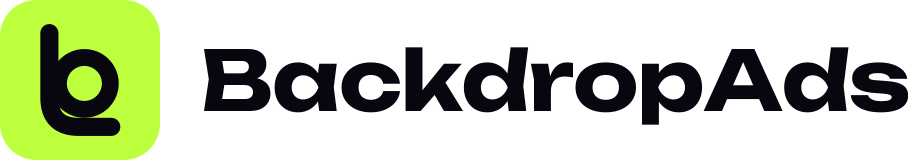
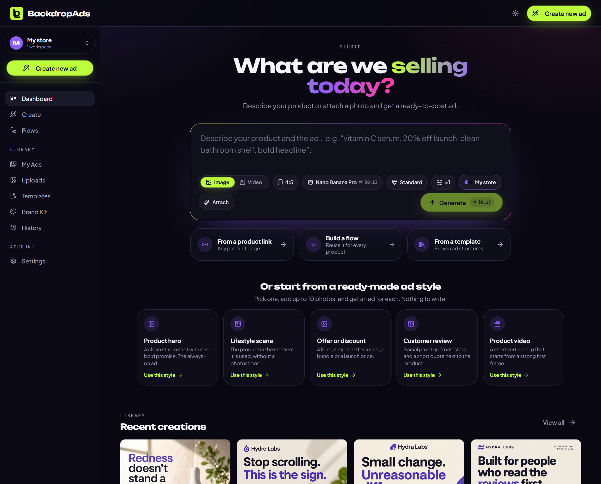
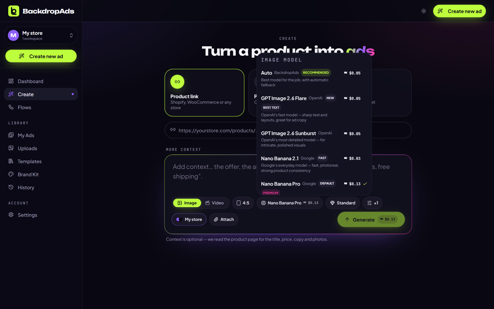
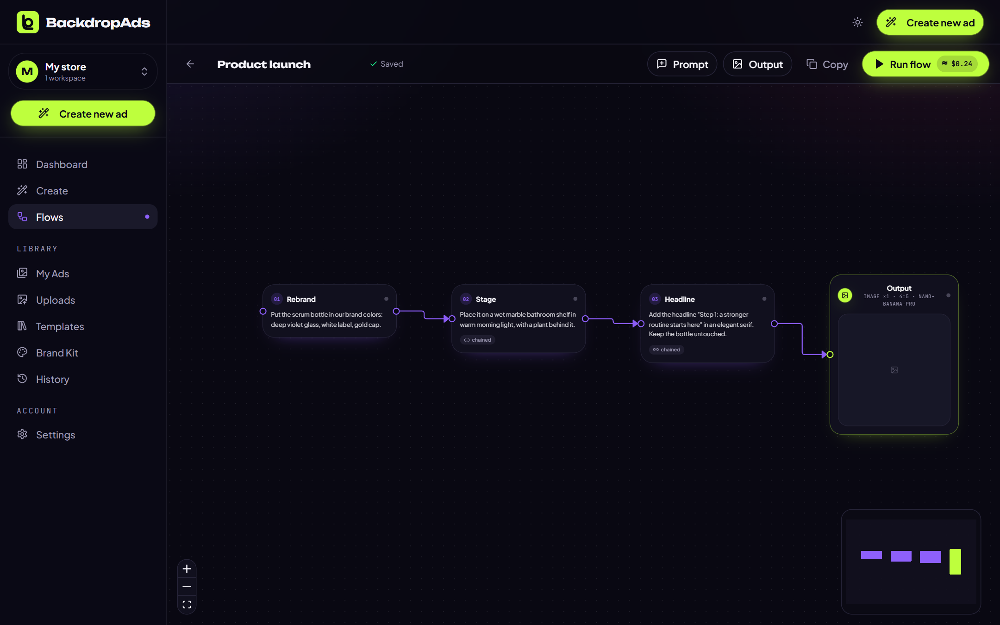
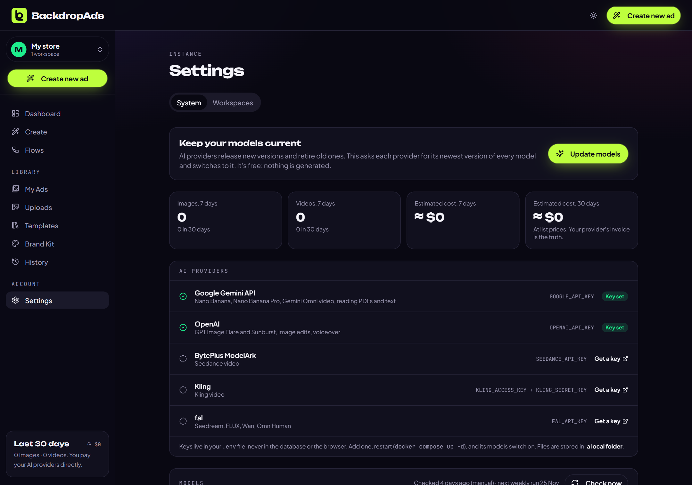

<h1 align="center">
  <picture>
    <source media="(prefers-color-scheme: dark)" srcset="docs/brand/backdropads-logo-on-dark.svg">
    
  </picture>
</h1>

<p align="center"><b>Turn your product into ads in minutes.</b> Open source, on your own AI keys.</p>

[](LICENSE)


**Start from a photo, a link or a short description, pick an ad style, and get finished image and video ads.**
They come out sized for Instagram, Facebook, TikTok, YouTube, Pinterest and Google Display. Many products? Run
up to 10 photos in one go.

An ad style is a flow: a few steps written as plain sentences ("clean backdrop", then "add a headline"). Use a
ready-made one or write your own, pick the AI model, see what it will cost before it runs, and download the
results.

BackdropAds is open source and you host it yourself. You plug in your own Google or OpenAI key and pay them
directly: about $0.03 for an image with Nano Banana, about $0.70 for a 10-second video with Gemini Omni.
No subscription, no credits, no markup.

This repository is the whole app. One command starts it. There is no account to create.



## Features

- **Flows.** Chain steps written as plain sentences (clean backdrop, then headline, then format) into a
  pipeline that ends in images or videos. Start from one of the starter flows or from a blank one.
- **Run on photos.** Pick up to 10 photos and the flow runs once for each, one after another. One flow, a whole
  set of ads.
- **Share flows as files.** Export a flow and import it somewhere else. A file carries the steps and settings,
  never your photos.
- **Start from anything.** A prompt, a photo, several photos, or a link to a page. Refer to photos in the
  prompt: "put the serum from image 1 next to the cream from image 2".
- **Sized for every platform.** Pick the platform and placement (feed, story, reel, short, pin, display) and
  the ad comes out in the right shape.
- **Pick the model.** Nano Banana, GPT Image, Gemini Omni, Seedance, Kling, FLUX and more, each with its
  estimated cost shown before you generate.
- **No silent swaps.** If the model you picked isn't responding, you're offered a working one. You choose.
- **Upload library.** Every photo, PDF and text file you upload stays available for the next ad. PDFs and text
  are read by an LLM first, so only the relevant facts reach the image or video prompt.
- **Refine with a sentence.** "Make the background darker." Every version is kept.
- **Brand kits and workspaces.** One workspace per brand, project or client, each with its own colors, voice and ads.
- **Know what you spend.** Usage and estimated cost for the last 7 and 30 days, per model.
- **Easy on a small machine.** AI jobs go through a queue (2 images and 1 video at a time by default), so a
  batch never starts everything at once.
- **Models that stay current.** Providers retire models all the time. A weekly check tells you when one is gone,
  and one button (**Update models**) moves every model to its provider's newest version.

| Every model shows its cost | A flow: steps in, ads out |
|---|---|
|  |  |

## What it costs

You pay the AI providers, nothing else. Estimates at list prices:

| | Model | Estimated cost |
|---|---|---|
| Image | Nano Banana 2.1 | $0.03 to $0.05 per image |
| Image | GPT Image 2.6 Flare | $0.05 to $0.21 per image |
| Image | Nano Banana Pro | $0.13 per image |
| Video | Gemini Omni 1.2 Flash | $0.07 to $0.10 per second |
| Video | Kling 3.0 | $0.08 to $0.17 per second |
| Video | Seedance 2.5 | $0.23 to $0.57 per second |

The app shows the estimate for every model before you generate. Your provider's invoice is the truth.

## Quick start

You need [Docker](https://docs.docker.com/get-docker/) and one AI key (Google or OpenAI).

```bash
git clone https://github.com/TarasRohovets/backdropads.git
cd backdropads
cp .env.example .env        # paste your key(s) into .env
docker compose up -d
```

Open **http://localhost:3000** and start creating.

- **No key yet?** Set `AI_USE_MOCK=true` in `.env` to look around with placeholder results.
- **Another port?** Set `WEB_PORT` in `.env`.
- **Updating?** `git pull && docker compose up -d --build`. Your data stays in two Docker volumes (`db` and `media`).

## AI providers

Add the keys you have to `.env`. A provider without a key is skipped. **Settings → System** shows which are set.

| Provider | `.env` key | Powers |
|---|---|---|
| [Google Gemini API](https://aistudio.google.com/apikey) | `GOOGLE_API_KEY` | Nano Banana, Nano Banana Pro, Gemini Omni video, reading PDFs and text |
| [OpenAI](https://platform.openai.com/api-keys) | `OPENAI_API_KEY` | GPT Image Flare and Sunburst, image edits, voiceover |
| [BytePlus ModelArk](https://console.byteplus.com/ark) | `SEEDANCE_API_KEY` | Seedance video |
| [Kling](https://app.klingai.com/global/dev) | `KLING_ACCESS_KEY`, `KLING_SECRET_KEY` | Kling video |
| [fal](https://fal.ai/dashboard/keys) | `FAL_API_KEY` | Seedream, FLUX, Wan, OmniHuman |

One key is enough to start. A Google key alone covers images, video and document reading.

## Keeping models current

AI providers ship new model versions every few weeks and switch old ones off. BackdropAds handles that in two steps:

- **A weekly check** asks each provider whether the models you use still exist and shows the result in
  **Settings → System**. It only reports.
- **Update models** (the button at the top of that page) asks OpenAI, Google and fal for the newest version of
  every model and switches to it. It's free, takes a few seconds, and **Use built-in versions** undoes it.
  BytePlus and Kling have no model listing, so those two are updated with the app.



Model ids in the app name a family, not a version (`gpt-image-flare`, `nano-banana`). The version each one runs
is a setting in `api/appsettings.json`, and the button saves newer ones in the database on top of it.

## Security

BackdropAds has **no accounts and no sign-in**. Whoever can open the app can use it, and every ad they generate
is paid for with your AI keys.

- **Private by default.** It only answers on the computer it runs on (`BIND_ADDRESS=127.0.0.1`).
- **Trusted network?** Set `BIND_ADDRESS=0.0.0.0` in `.env` to reach it from other devices.
- **Not for the public internet as it is.** For remote access, put your own protection in front of port 3000:
  a VPN such as Tailscale or WireGuard, or a reverse proxy (Caddy, nginx) with a password and HTTPS.
- **Keys stay on the server.** They live in `.env`. They are never stored in the database or sent to the browser.
- **Only the web app is exposed.** The database and the API are not reachable from outside Docker.
- **Rate limits** (`RateLimits` in `api/appsettings.json`) cap how fast anything can spend your AI budget.

## How it's built

```
web/   Next.js app: the UI. Proxies /api and /media to the API, so the browser talks to one origin.
api/   .NET 9 API: generation pipeline, flows, uploads, settings. PostgreSQL via Dapper.
```

- **Database:** PostgreSQL. The schema is plain SQL in `api/migrations/`, applied on startup.
- **Files:** a folder on a Docker volume. Set `Azure__BlobConnectionString` and `Azure__ContainerName` on the
  API to use Azure Blob Storage instead.
- **Models:** `api/appsettings.json` holds the model versions and the order "Auto" tries them in.

## Development

Run the database in Docker and the two apps on your machine:

```bash
docker compose -f docker-compose.yml -f compose.dev.yml up -d db

cd api
export ConnectionStrings__PostgresConnection="Host=localhost;Database=backdropads;Username=backdropads;Password=backdropads"
export AI__Google__ApiKey=...          # or put settings in api/appsettings.Development.json (gitignored)
dotnet run                             # http://localhost:5210, Swagger at /swagger

cd web
npm install
npm run dev                            # http://localhost:3000
```

To change the schema, add the next file to `api/migrations/` (for example `002_add_x.sql`). Every file runs at
startup in name order, so each must be safe to run twice (`IF NOT EXISTS`).

## Contributing

Issues and pull requests are welcome. For anything larger than a fix, open an issue first so we can agree on
the approach.

By contributing you agree that your contribution is licensed under AGPL-3.0 and may also be included in
hosted editions of BackdropAds.

## License

[AGPL-3.0](LICENSE). Copyright (c) 2026 Taras Rohovets.

Use it, self-host it and change it freely. If you run a modified version as a service for other people, you
must publish your changes under the same license.
